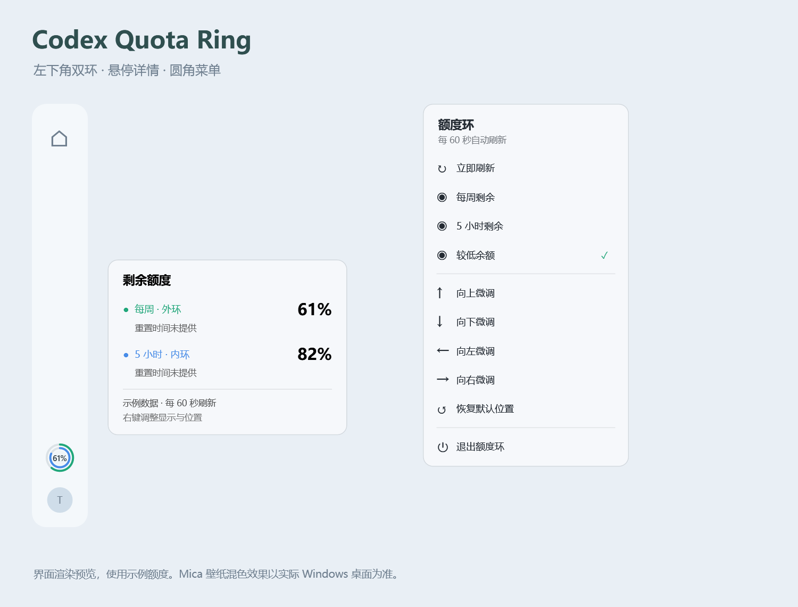

# Codex Quota Ring

个人闲着玩，和 Codex 一起做的一个 Windows 小工具。

之前 Codex 左下角头像上面有个额度圈，后来没了，就想自己补一个。大概能用，但没做过太多测试，主要在自己的电脑上试了试。可能会有 bug，也不保证以后 Codex 更新了还能正常用。

## 效果图



上图由实际 WPF 控件渲染，额度是示例数据，侧栏仅为位置示意。Mica 在实际桌面上的混色效果取决于 Windows 设置，图里用了纯色底。

## 有什么

- 固定在 Codex 左下角头像右侧的小圆环，避开头像上方的更新按钮。按住左键直接拖动，松开自动保存位置，也可以右键微调。
- 外环绿色是每周剩余，内环蓝色是 5 小时剩余。
- 中间默认显示两项中较低的百分比，也可以切换成每周或 5 小时。
- 鼠标放上去或轻点看详情和重置时间，拖动时不弹详情，右键打开设置；两者都用了圆角和 Mica。
- Codex 失去焦点后仍保留圆环，跟随窗口层级。最小化、关闭或不在当前虚拟桌面时隐藏。
- 启动时读取一次，之后每次请求结束约 60 秒后再刷新，也可以手动刷新。

如果接口没有返回 5 小时额度，就显示灰环和“未提供”，不会自己算一个出来。读取失败时保留旧数据并做标记。每周额度按服务端窗口计算，不是每周一自动清零。

## 下载和使用

去 [Releases](https://github.com/Tomclanc/codex-quota-ring/releases) 下载 ZIP，完整解压后运行 `CodexQuotaRing.exe`。

需要：

- Windows 11；Mica 需要 Windows 11 22H2 或更新版本。不支持时尝试回退到纯色。
- [.NET 8 Desktop Runtime](https://dotnet.microsoft.com/download/dotnet/8.0)（下载 **Desktop Runtime**，不是普通 Runtime）。
- Microsoft Store 版 Codex 桌面应用，以及已通过 ChatGPT 登录的本机 Codex CLI。

目前只匹配安装路径包含 `OpenAI.Codex` 的 `ChatGPT.exe` / `Codex.exe` 窗口，其他安装渠道没有适配。CLI 会从本机 OpenAI/Codex 目录或 PATH 查找，也可以通过 `CODEX_BINARY` 指定路径。

如果桌面端和 CLI 登录了不同账号，显示的是 CLI 的额度。

右键可以调整中间数字、上下左右位置和退出。位置保存在程序目录下的 `settings.json`，建议放在有写入权限的目录。没有自动更新。使用 `CodexQuotaRing.exe --watch` 启动可在进程意外退出后自动恢复；从右键菜单主动退出会同时停止恢复。需要登录启动时，可将带 `--watch` 参数的快捷方式放入 Windows 启动文件夹；移除该快捷方式即可取消。旧版默认位置会自动迁移到头像右侧，自定义位置保留。退出后删除文件夹即可移除。

## 测试情况

目前只做了编译、少量额度解析检查、本机接口读取和界面试用。多显示器、不同缩放、深色模式、窗口关闭重开和后续 Codex 版本都没有做完整回归。原生悬浮窗的层级、Mica 和定位也可能在不同机器上有差异。

这是独立的个人小项目，和 OpenAI 官方没有关系。

## 数据从哪里来

通过本机 Codex App Server 的 `account/rateLimits/read` 读取额度，使用 Codex 自己管理的登录状态。

程序不直接读取登录凭证、不读取聊天记录，也不发送模型请求、购买额度或使用重置券。没有遥测。查询额度时，Codex 自身可能会联系服务端。

## 自己编译

安装 .NET 8 SDK 或更新的兼容 SDK，在 Windows 上运行：

```powershell
dotnet publish -c Release --no-self-contained -o app
.\app\CodexQuotaRing.exe
```

简单检查：

```powershell
Start-Process .\app\CodexQuotaRing.exe -ArgumentList '--test' -Wait
Get-Content .\app\tests.txt
```

`--check` 会把当前额度写入程序目录的 `check.json`，只用于本地排查，不要把自己的记录提交到仓库。`--gallery` 可以生成 README 中的界面预览。

## 参考

参考了 [ArloYi/Codex-Token-Monitor](https://github.com/ArloYi/Codex-Token-Monitor) 的额度浮窗思路和 App Server 读取方式。本项目重新实现了双环、固定位置、详情卡片与菜单。

[Codex App Server 文档](https://learn.chatgpt.com/docs/app-server)

MIT License。
